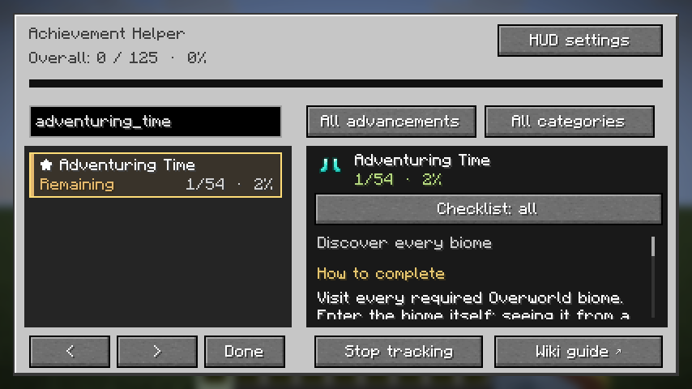
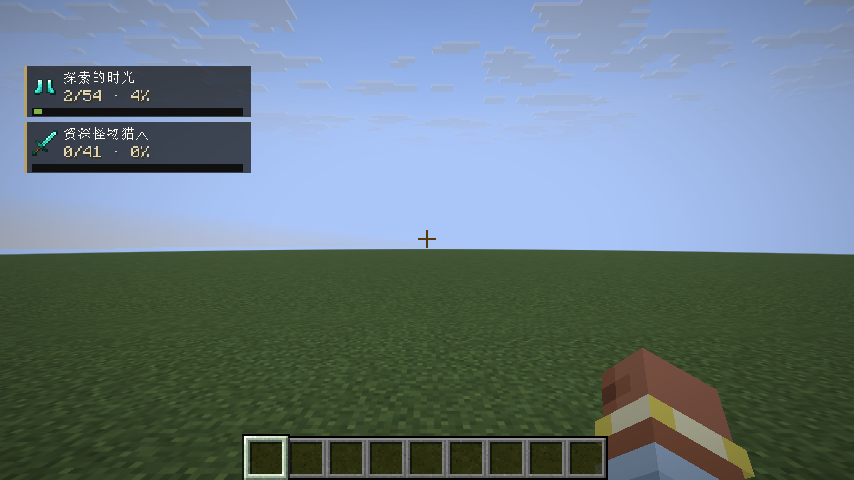

# Achievement Helper

Minecraft **26.1.2** · NeoForge **26.1.2.122+** · Java **25**

An advancement companion for players working toward every advancement. Read completion guides, check missing requirements, and track goals on the HUD. This repository includes the full source code, resources, build tools, and an isolated client integration test.

## Getting started

1. Install Minecraft 26.1.2 and a compatible NeoForge version, then place `achievement_helper-0.1.1.jar` in your `mods` folder.
2. Enter a world and press **H** to open the panel. Change the shortcut under **Options → Controls → Key Binds → Achievement Helper**.
3. Select an advancement on the left to see its guide, completion percentage, and requirement checklist on the right. Scroll each pane independently; the details pane also supports Page Up / Page Down.
4. Search by advancement name or ID. Use the buttons above the list to cycle through completion statuses and categories. In the details pane, filter requirements by all, remaining, or completed.
5. Click **Track** to display a goal on the HUD. Track up to five goals at once. Completed goals are automatically removed, and you can stop tracking a goal manually.
6. Click **HUD settings** in the top-right corner to drag the tracker to a new position or fine-tune it with the X / Y buttons. Use − / + to adjust its size from 50% to 125% (default: 80%). Settings are saved when you close the settings screen; a reset button restores the defaults.
7. The interface follows the game language: Simplified Chinese and English are supported, with English fallback for other languages. Vanilla names use Minecraft's own translations.

**Multiplayer requires the mod on both the client and server.** Singleplayer synchronizes automatically through its integrated server. Servers without the mod cannot provide the full hidden advancement catalogue and requirement data. The panel displays a synchronization notice rather than treating missing data as a real 0% result.

## Features





- English and Simplified Chinese completion guides for all 125 vanilla Minecraft 26.1.2 advancements, including hidden advancements.
- Search, completion status filters, vanilla categories, and a separate category for other mod or data pack advancements.
- Green and brown-gold row backgrounds, explicit status labels, and progress numbers distinguish completed and incomplete advancements. The selected row has its own outline.
- Completed and remaining requirement checklists for biomes, monsters, foods, cats, wolves, and other advancement criteria.
- Overall completion calculated as completed advancements divided by all advancements with display information. Background recipe unlock advancements are excluded.
- Individual percentages taken directly from the server's vanilla progress calculation. Every requirement group must be satisfied; within a group of alternatives, one option is enough.
- “A Furious Cocktail” and “How Did We Get Here?” show the effects that the current world requires simultaneously, rather than presenting them as a permanent cumulative checklist.
- Tracking saved separately for each world, player, and server, and restored after reconnecting or synchronizing again. The HUD stays above the bottom hotbar area and only displays goals that fit on screen.
- A Wiki button that opens the corresponding guide chapter through Minecraft's built-in external link confirmation screen. Built-in tips are available offline.
- Custom advancement descriptions and requirements read from server data. Dedicated walkthroughs are not provided for every third-party mod.

## Building

Install **JDK 25** and point `JAVA_HOME` to it. From the project directory, run:

```powershell
.\gradlew.bat build
```

On Linux / macOS:

```sh
./gradlew build
```

Build outputs:

- `build/libs/achievement_helper-0.1.1.jar`: the mod to install in Minecraft.
- `build/libs/achievement_helper-0.1.1-sources.jar`: the Java source archive.

The first build needs an internet connection to download Gradle, NeoForge, and Minecraft development dependencies. The Gradle Wrapper is included, so a separate Gradle installation is unnecessary. Launch the development client with `gradlew.bat runClient` on Windows or `./gradlew runClient` on Linux / macOS.

## Validation and contributing

```powershell
python scripts/build_translations.py
python scripts/check_resources.py
.\gradlew.bat build
.\gradlew.bat -PsmokeTest runClient
```

The final command launches a real client and creates a flat test world in the isolated `run-smoke` directory. It checks the full catalogue, hidden advancements, partial progress, effect requirements, Chinese language switching, restored tracking, automatic removal of completed goals, advancement revocation, HUD dragging, size controls, saved HUD settings, screen bounds, and completed/incomplete rows. The test exits automatically, writes its result to `run-smoke/smoke-result.txt`, and saves screenshots under `run-smoke/screenshots`. It requires a working graphical desktop. Standard CI runs the build and resource checks only.

Edit bilingual completion guides in `content/guides.tsv` and interface text in `content/ui.tsv`. After editing, run the translation generation script and commit both generated language JSON files. You can also run `python scripts/check_resources.py <path-to-26.1.2-client.jar>` to verify coverage against every vanilla advancement in that version.

Run `python scripts/package_source.py` to create a shareable ZIP of the complete source project. When uploading to GitHub, include `src`, `content`, `scripts`, `gradle`, `.github`, and the root configuration files. The `.gitignore` excludes local JDKs, build caches, logs, and test worlds. CI automatically produces mod and source artifacts.

## Project structure

```text
src/main/java/dev/achievementhelper/   Mod entry point, server synchronization, network messages
src/main/java/.../client/              Vanilla-style panel, HUD, tracking, and guides
src/main/resources/assets/.../lang/   In-game English and Simplified Chinese resources
src/main/templates/META-INF/          NeoForge metadata
src/smoke/                            Real-client integration tests, excluded from release JARs
content/                              Editable bilingual guides and interface text
scripts/                              Translation generation, resource checks, source packaging
.github/workflows/                    GitHub build automation
```

Tracking is stored in `config/achievement_helper_tracking.json` inside the game directory. HUD position and size are stored separately in `config/achievement_helper_hud.json`, with positions expressed relative to the available window space. Only goal IDs and interface preferences are saved; the mod does not modify the world's vanilla advancement files.

Vanilla Minecraft stops recording some alternative criteria after an advancement is complete. The panel therefore shows criteria recorded by the advancement system, rather than a complete history of everything the player has done after completion.

## References and version information

The guides contain original short explanations informed by the [Minecraft Wiki advancement guide](https://minecraft.wiki/w/Tutorial:Advancement_guide). **Advancement counts and requirements for 26.1.2 follow Mojang's published data for that version**, rather than totals from later Wiki versions. The project is based on the [official NeoForge MDK](https://github.com/NeoForgeMDKs/MDK-26.1.2-ModDevGradle).

The current version is 0.1.1. Project metadata retains `All Rights Reserved`. Minecraft itself and its development dependencies are not bundled or redistributed.
